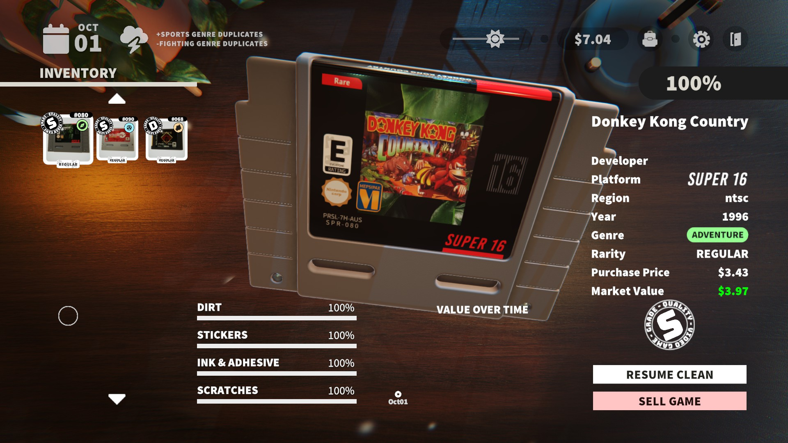

# Cozy Cart Art

[BepInEx](https://github.com/BepInEx/BepInEx) v5 plugin for [Cozy Game Restoration](https://store.steampowered.com/app/3581230/Cozy_Game_Restoration/): replace cartridge front and rear labels and rename cartridges from local files. No game file is modified. 

Tested with BepInEx version `5.4.23.6`.

## Install

- Download the DLL from the [releases page of this repository](https://github.com/Kartones/cozy-card-art-plugin/releases/latest/).
- With the game closed, then copy `CozyCartArt.dll` to `<game-folder>\BepInEx\plugins\`. 
- Launch the game once: it creates `<game-folder>\BepInEx\config\CozyCartArt\` containing `front\`, `rear\` and `titles.txt`
- Check `<game-folder>\BepInEx\LogOutput.log` for `Cozy Cart Art loaded` and `Applied N title override(s)`
- Uninstall: delete `CozyCartArt.dll`

## Use

- Replace art
  - Create a PNG, with the same name and resolution and path as the `templates` folders in this repository, but inside `<game-folder>\BepInEx\config\CozyCartArt\`. There are `files.txt` listing all valid file names and their resolutions
  - Front, first match wins: `<gameId>_<platform>_<region>.png` (one variant, e.g. `game001_nebula_ntsc.png`), then `<gameId>.png` (all variants of that game)
  - Rear, first match wins: `<gameId>_<platform>_<region>.png`, then `<gameId>.png`, then `<platform>_<region>.png` (shared by every game of that platform variant)
  - Names are lowercase, region is `ntsc` or `pal`
  - Restart the game to see changes
- Rename cartridges (game titles)
  - Edit `<game-folder>\BepInEx\config\CozyCartArt\titles.txt`, one line per game: `game001 = My Title`
  - Lines starting with `#` are comments; game ids are in `..\CozyCartAssets\game-titles.csv`
  - This only changes the menu text, not label art prints
  - Restart the game to see changes

### Example

Example **not** present in the repository. Replacing game 80, `Gorilla Adventure County` by the real title, `Donkey Kong Country`:

`titles.txt`
```ini
game080 = Donkey Kong Country
```



The replacement cover is AI-generated to quickly test that the plugin works, it contains mistakes.


## Limitations

- `super16_pal` rear was not found in the game data


## Build

- Needs the .NET SDK and the game installed
- Tests (not included): `cd tests; dotnet test`
- Build: `cd src; dotnet build -c Release`
- Other game location: add `-p:GameDir="<path to Cozy Game Restoration>"` (default `C:\Games\Steam\steamapps\common\Cozy Game Restoration`)
- Output: `src\bin\Release\netstandard2.1\CozyCartArt.dll`
